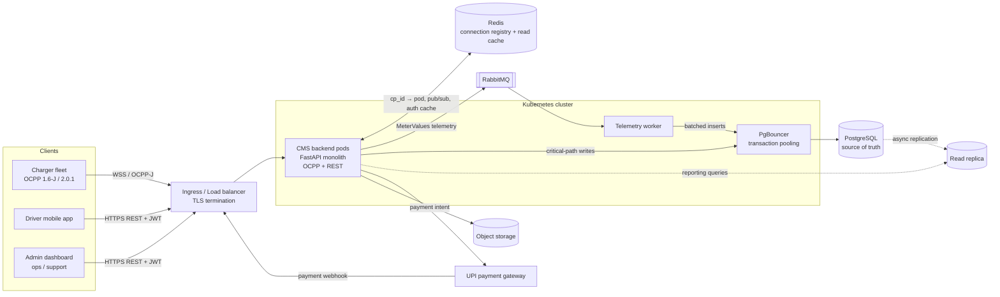

# 01 — System Overview

Vega CMS is the Charger Management System (CSMS in OCPP terms) for the Vega Charge EV charging fleet. It manages charge points over OCPP, serves the driver mobile app and the ops admin dashboard, and integrates with a third-party UPI gateway for payments.

| | |
|---|---|
| **Scale target** | 1,000 stations × 3–5 chargers = 3,000–5,000 charge points |
| **Protocols** | OCPP 1.6-J and OCPP 2.0.1, dual-stack from day one |
| **Backend** | FastAPI (Python), modular monolith |
| **Ownership (MVP)** | All stations Vega-owned and Vega-operated; franchising deferred |

## System context and request paths



### Rules the diagram encodes

- **One front door.** Chargers, the app, the dashboard and gateway webhooks all enter through the same Ingress/LB. A WebSocket is an upgraded HTTP connection, so the same TLS termination and routing apply.
- **One backend for app and dashboard.** Driver routes (`/sessions/...`) and admin routes (`/admin/...`) are route groups in the same service, separated by JWT role claims, not separate services.
- **RabbitMQ is never a front door.** Chargers cannot speak AMQP. Pods parse OCPP first, then publish high-volume `MeterValues` to RabbitMQ for a worker to write.
- **Critical-path writes skip the queue.** `BootNotification`, `StatusNotification` and transaction start/stop go straight from the pod to Postgres so the charger's ack reflects durable state.
- **Redis is never authoritative.** It holds the connection routing table and read caches. Postgres is the source of truth.
- **Reporting reads go to the replica.** Wide dashboard scans never compete with a `StartTransaction` waiting for its ack.

> **Correction on record:** an earlier sketch had chargers bypassing the Ingress straight into the cluster and omitted RabbitMQ. Both are wrong. All client types share one ingress, and RabbitMQ sits *behind* the pods.

## Component responsibilities

| Component | Owns | Does not own |
|---|---|---|
| CMS backend pods | OCPP sessions, message handling, REST API, CSMS-initiated commands | Any durable state (pods are stateless and disposable) |
| Telemetry worker | Consuming `MeterValues` from RabbitMQ, batched inserts into `meter_values` | Transaction state |
| Redis | `charge_point_id → pod_id` registry (TTL), command pub/sub, auth-decision read cache | Truth about tokens, transactions or connectors |
| RabbitMQ | Buffering telemetry bursts | Critical-path OCPP messages |
| PostgreSQL primary | All durable state | Heavy reporting queries |
| Read replica | Admin reporting / analytics | Anything needing read-your-writes |
| PgBouncer | Capping Postgres connections across autoscaled pods | — |
| UPI gateway | Payment collection and settlement | Charging authorization logic |

The telemetry worker runs from the same codebase as the API pods with a different entrypoint. It is a separate Deployment, not a separate service.

## Codebase layout

```
app/
  core/         settings (pydantic-settings), logging, lifecycle / drain
  db/           engine, session factories (primary + replica), Base
  models/       SQLAlchemy models — version-agnostic
  schemas/      Pydantic request/response models
  ocpp/         WebSocket endpoint, version negotiation, 1.6 + 2.0.1 handlers,
                command dispatch, Redis connection registry
  api/admin/    ops / support routes
  api/driver/   mobile app routes
tests/
  unit/
  integration/  real Postgres; full Boot → Authorize → Tx → MeterValues → Stop
alembic/
```

The monolith is modularized along these boundaries so it *can* be split later. See [ADR-0003](../adr/0003-modular-monolith.md).

## Roles (MVP, Vega-only)

| Role | Who | Key permissions |
|---|---|---|
| Driver | App end user | Start/stop own sessions, view own history, pay |
| Station operator | Vega site staff | Manage assigned station(s), revenue for those stations only |
| Fleet/network admin | Vega Charge ops | Full fleet control: remote commands, firmware, all reporting |
| Support | Vega customer support | Read-only session/charger lookup, manual session termination |
| Super admin | Vega platform owner | User/role management, system configuration |

Hardware vendor is an attribute of the charger record, not a role. Nothing in the design assumes a single hardware brand. RBAC is Phase 2. Phase 1 admin API is read-only and unauthenticated in dev only.

## Related

- [02 — Deployment & infrastructure](02-deployment.md)
- [03 — Key flows](03-flows.md)
- [04 — Data model](04-data-model.md)
- [05 — OCPP protocol notes](05-ocpp.md)
