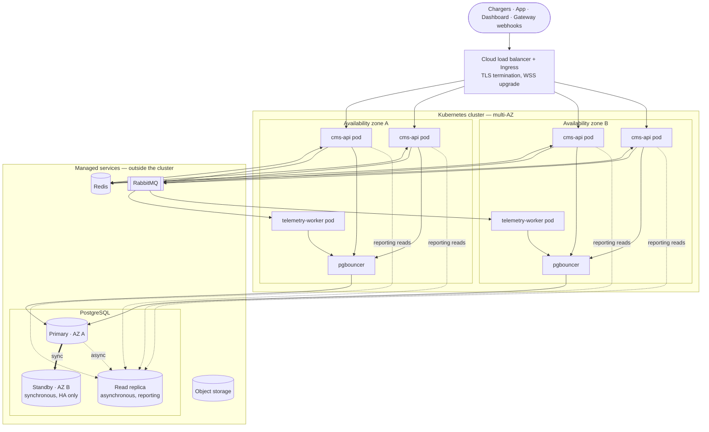

# 02 — Deployment & Infrastructure

## Topology



PgBouncer is shown in-cluster. A provider-managed pooler (for example RDS Proxy) is an equally valid choice, and the requirement is only that *something* pools connections from day one.

## Stateless pods and the routing problem

The cms-api Deployment runs **3–6 stateless pods across ≥ 2 AZs**. Exactly one pod holds the live WebSocket for any given charger, so a command originating anywhere (an admin REST call, a payment webhook) must find that pod.

- On connect, the owning pod writes `charger:{cp_id}:pod = {pod_id}` to Redis with a TTL.
- Every `Heartbeat` (and any inbound message) refreshes the TTL.
- Each pod subscribes to its own channel `cmd:{pod_id}`. Commands are routed by looking up the owner and publishing to that channel. The full sequence is in [03 — Key flows](03-flows.md#csms-initiated-command-routing).
- Build the registry in Phase 1 even while running a single pod. Retrofitting it into handler code later is the expensive path.

### Deregistration must be compare-and-delete

A charger that is disconnected by pod A can reconnect to pod B within milliseconds. If pod A then runs a plain `DEL`, it erases pod B's fresh registration and the charger becomes unreachable for commands until its next heartbeat. Pods may only delete a key whose value is still their own pod ID:

```lua
-- KEYS[1] = charger:{cp_id}:pod   ARGV[1] = this pod's id
if redis.call("GET", KEYS[1]) == ARGV[1] then
  return redis.call("DEL", KEYS[1])
end
return 0
```

This applies to **every** socket close, not just shutdown drains.

## Autoscaling on connections, not CPU

The workload is mostly idle, long-lived WebSockets. CPU stays flat right up until memory or file-descriptor limits are hit, so a CPU-based HPA never fires when it matters.

- Each pod exports an `ocpp_active_connections` gauge.
- The HPA scales on that metric (via Prometheus Adapter or KEDA) with a per-pod target set well below the measured per-pod ceiling.
- Measure the ceiling with the SAP `e-mobility-charging-stations-simulator` during load testing before fixing the target.
- New pods only receive *new* connections. Existing chargers do not rebalance until they reconnect. This is acceptable because chargers reconnect regularly, and it is why scale-out should happen early rather than at the ceiling.

## Graceful drain on rolling deploys

Without a drain, every rollout disconnects a share of the fleet at once and triggers a reconnect storm.

On `SIGTERM`:

1. Mark the readiness probe as failing so the LB stops sending **new** connections. Existing sockets stay open.
2. Wait ~5 s for LB deregistration to propagate.
3. Run a bounded drain window (60–90 s). Many connections close on their own as chargers reconnect.
4. Close remaining sockets with WebSocket code **`1001` (going away)**, not a TCP reset. Firmware treats this as a normal disconnect and reconnects with standard backoff instead of faulting.
5. Deregister each closed connection from Redis using compare-and-delete.

```python
draining = False
active_connections: dict[str, WebSocket] = {}

async def on_shutdown() -> None:
    global draining
    draining = True
    readiness_probe.set_unhealthy()
    await asyncio.sleep(LB_DEREGISTER_WAIT_SEC)          # ~5s

    deadline = time.monotonic() + DRAIN_TIMEOUT_SEC      # 60–90s
    while active_connections and time.monotonic() < deadline:
        await asyncio.sleep(1)

    for cp_id, ws in list(active_connections.items()):
        await ws.close(code=1001, reason="server draining")
        await registry.release(cp_id, POD_ID)            # compare-and-delete, not DEL

    await db_engine.dispose()
    await redis.aclose()
```

Kubernetes settings:

- `terminationGracePeriodSeconds`: 90–120 (above the 30 s default and above `DRAIN_TIMEOUT_SEC`).
- A `preStop` hook sleeping 2–3 s before `SIGTERM` is delivered.
- `maxUnavailable: 0` and a small `maxSurge` on the rolling update, so capacity never drops during a rollout.

**Why this is safe:** connector and transaction state is written to Postgres the moment it is reported, never batched in pod memory. A forced disconnect mid-transaction loses only the socket registration. The charger keeps charging and resumes reporting after reconnect.

## PostgreSQL

### Load profile

`meter_values` dominates: ~1.5–2 M rows/day, ~600–700 M rows/year, ~100 GB/year at full utilization. Everything else is small by comparison. Because RabbitMQ absorbs bursts, sustained write load is ~20–25 writes/s.

### Starting size

A mid-tier instance (4 vCPU, 16–32 GB RAM, autoscaling general-purpose SSD) is sufficient to start. Scale vertically first before adding infrastructure.

### Connection pooling

4–6 pods × 10–20 connections each is 60–120+ connections before workers are counted. PgBouncer in **transaction pooling** mode sits in front of Postgres from day one.

Transaction pooling has one practical consequence for asyncpg: server-side prepared statement caching must be disabled (`prepared_statement_cache_size=0` on the asyncpg connection, `statement_cache_size=0`), or pooled connections will hit "prepared statement does not exist" errors.

### Replication — two replicas, two jobs

| Replica | Mode | Job | Queried? |
|---|---|---|---|
| Standby | Synchronous | HA failover only | No (unless the provider uses Aurora-style shared storage, where replicas are both HA and readable) |
| Read replica | Asynchronous | Admin dashboard reporting and analytics | Yes |

Replication lag is acceptable for a revenue dashboard and **not** acceptable for OCPP transaction state. Code must therefore use two session factories: `primary_session()` for anything OCPP- or payment-related, and `replica_session()` only for reporting endpoints.

### Partitioning

`meter_values` and `status_notifications` are range-partitioned by month from the first migration. See [04 — Data model](04-data-model.md#partitioned-tables) for the migration details.

## Environments and CI/CD

| | Local dev | CI | Staging / prod |
|---|---|---|---|
| Runtime | WSL2 Ubuntu 24.04, `uvicorn --reload` | GitHub Actions runner | Kubernetes |
| Postgres / Redis | `docker-compose.yml` | Service containers | Managed services |
| Purpose | Build + simulator testing | Lint, typecheck, unit + integration tests on every push | — |

CI is independent of the deployment target and is already running. CD (image build, push, rollout) is not yet defined.
