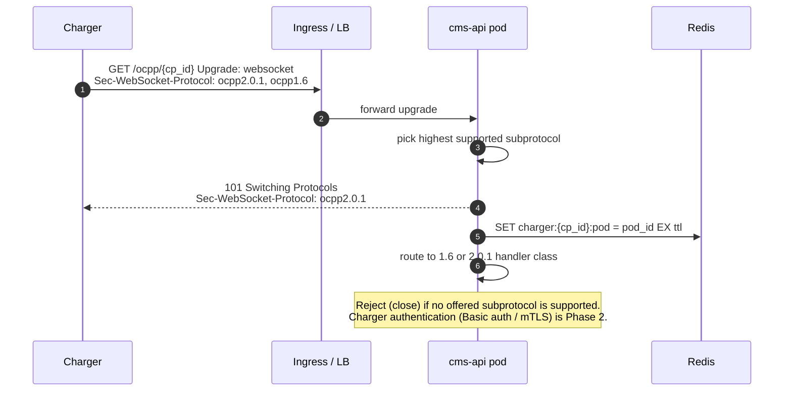
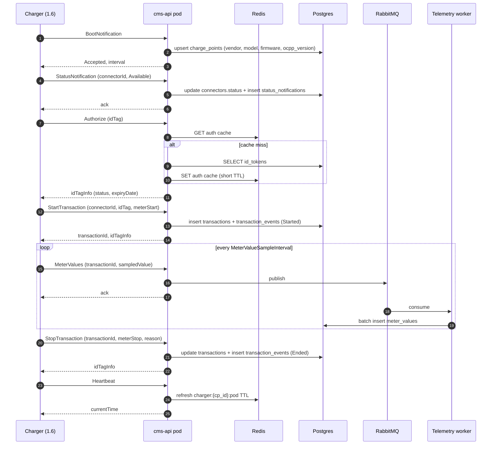
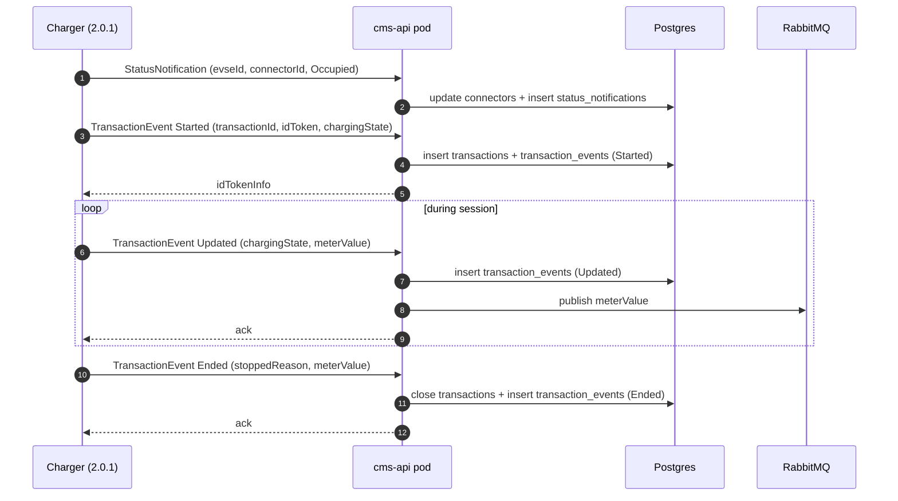
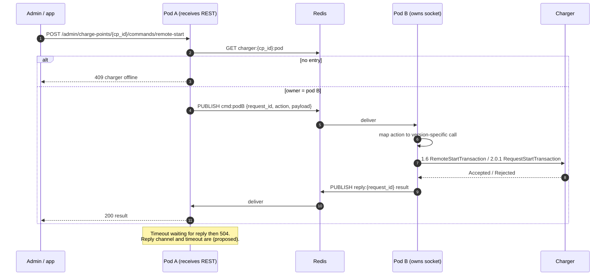
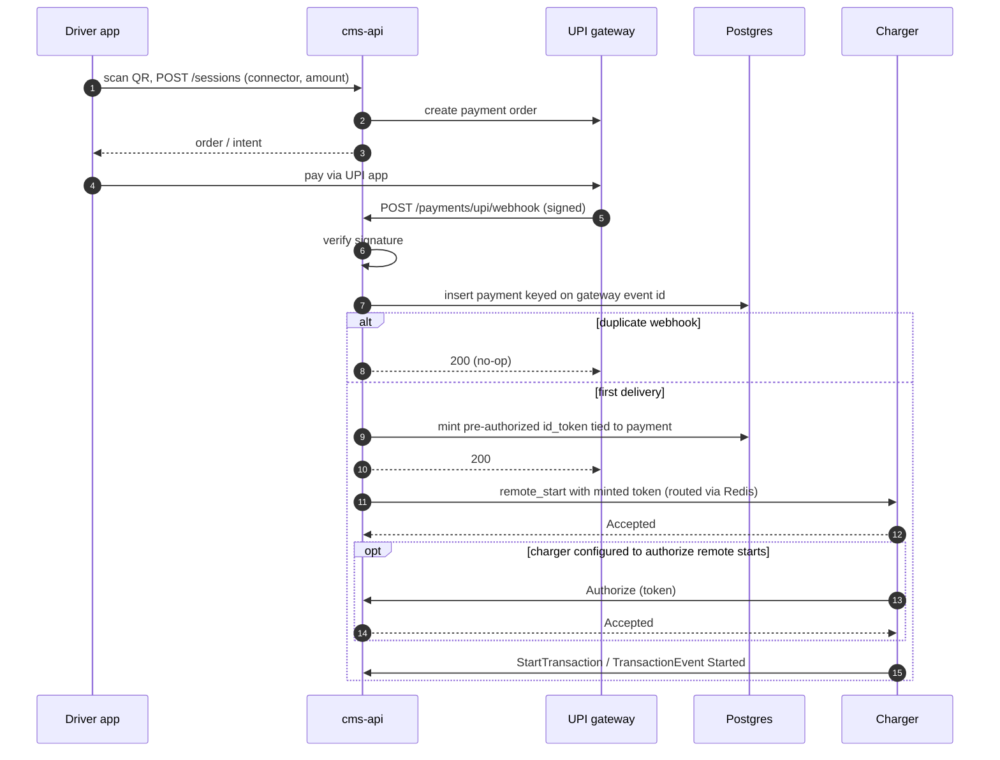
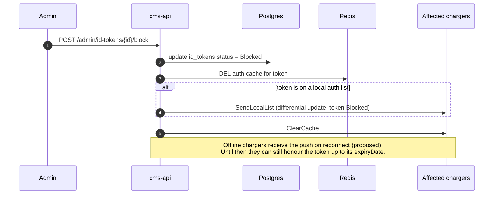
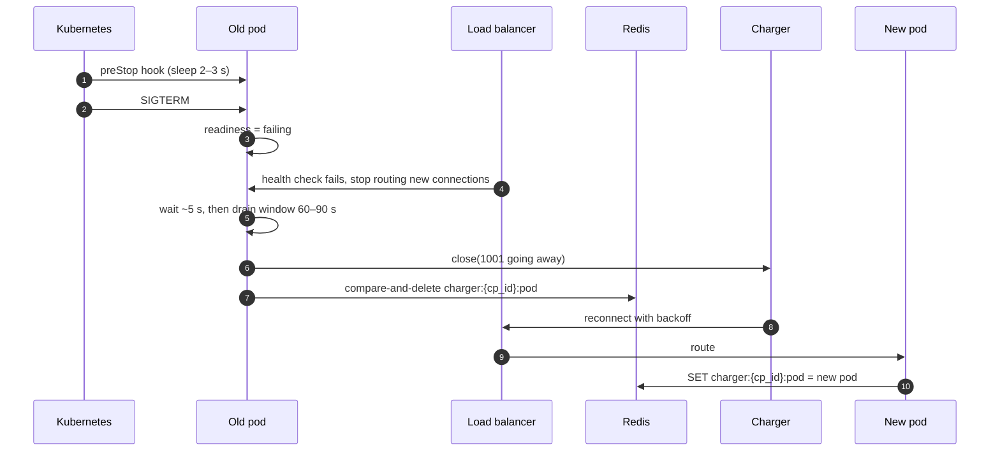

# 03 — Key Flows

Sequence diagrams for the flows that cross component boundaries. Elements marked **(proposed)** are design details added during documentation that are not yet implemented and should be confirmed during Phase 1.

## Connection and version negotiation

The OCPP version is chosen during the WebSocket handshake via `Sec-WebSocket-Protocol`. This is the single point where a charger's version is decided, and it is persisted to `charge_points.ocpp_version`.

## OCPP 1.6 — boot to stopped transaction

## OCPP 2.0.1 — transaction lifecycle

Same tables, one message type. `TransactionEvent` with `eventType` = `Started` / `Updated` / `Ended` replaces Start/Stop, and `Updated` events can carry `meterValue` inline.

Two differences from 1.6 that the handlers must respect:

- **The charger generates the transaction ID in 2.0.1.** In 1.6 the CSMS assigns `transactionId`. The `transactions` table therefore needs an internal surrogate key plus a version-agnostic `ocpp_transaction_id` text column, unique per charge point.
- **`seqNo` ordering.** 2.0.1 events carry `seqNo` and may arrive out of order after an offline period. Store it and order by it, not by arrival time.

## CSMS-initiated command routing

How a command issued on any pod reaches the pod holding the charger's socket.

Commands are expressed internally in version-neutral terms and translated at the owning pod:

| Internal action | OCPP 1.6 | OCPP 2.0.1 |
|---|---|---|
| `remote_start` | `RemoteStartTransaction` | `RequestStartTransaction` |
| `remote_stop` | `RemoteStopTransaction` | `RequestStopTransaction` |
| `reset` | `Reset` (Hard / Soft) | `Reset` (Immediate / OnIdle, optional `evseId`) |
| `unlock_connector` | `UnlockConnector` (connectorId) | `UnlockConnector` (evseId + connectorId) |
| `change_availability` | `ChangeAvailability` (connectorId, Operative/Inoperative) | `ChangeAvailability` (optional evse{id, connectorId}, operationalStatus) |
| `clear_cache` | `ClearCache` | `ClearCache` |

## UPI payment to charging session

Notes:

- **Do not depend on the `Authorize` step.** Chargers only send it after a remote start if `AuthorizeRemoteTxRequests` (1.6) or `AuthCtrlr.AuthorizeRemoteStart` (2.0.1) is true, and many default to false. The token must be valid either way. Set the key explicitly at boot so behaviour is predictable fleet-wide.
- **Webhook idempotency** is enforced by a unique constraint on the gateway's event / payment ID, not by an application-level check.
- **Reconciliation job (required):** finds payments marked successful with no transaction started within N minutes and either retries the start or triggers a refund.
- Tariff calculation and receipt generation happen at transaction end and are not shown.

## Token revocation

Blocking a token in the database is not enough. Chargers may still accept it from their authorization cache or local list.

Revocation lag is bounded by `idTokenInfo.expiryDate` for offline chargers. The expiry window is a security/resilience trade-off (see [open decisions](../open-decisions.md)).

## Graceful drain during a rolling deploy

