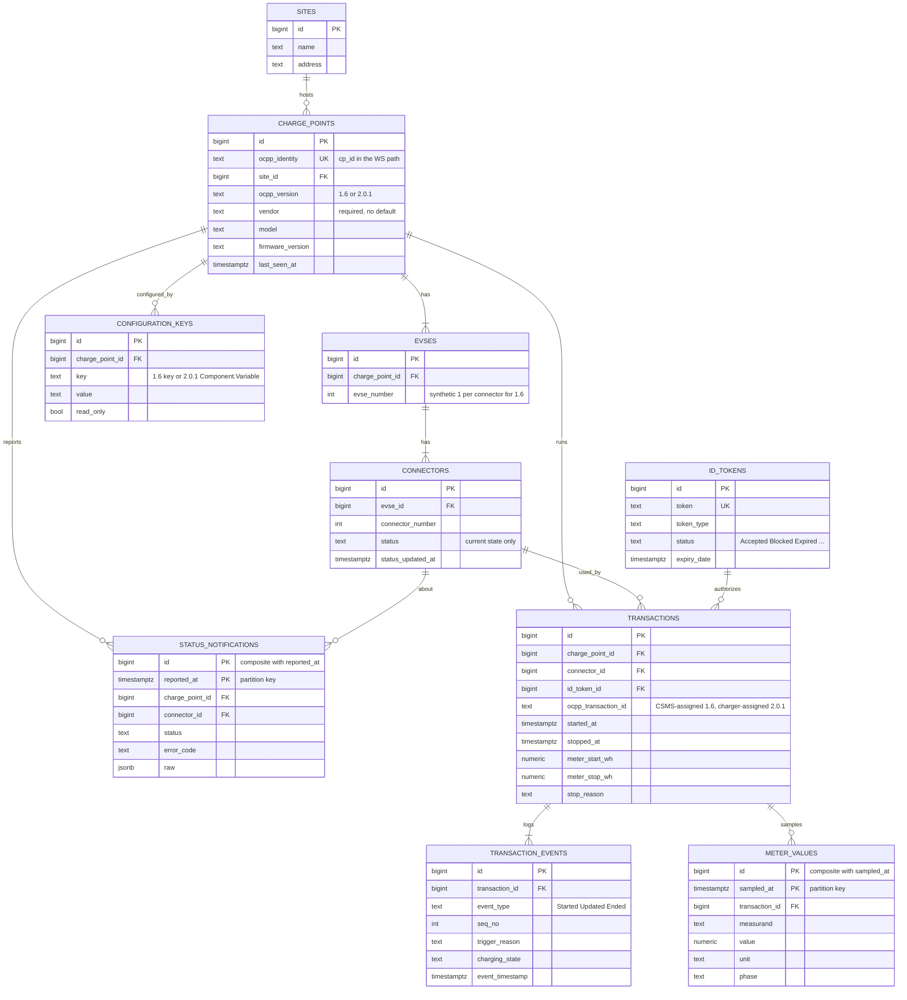

# 04 — Data Model

> **Source of truth:** `vega_cms_schema.sql`. This page explains the shape and the reasoning. Column lists below show keys and the columns that carry design decisions, not every column. If this page and the DDL disagree, the DDL wins and this page needs updating.

## Entity relationships



## Design decisions

### One schema for both protocol versions

There is one `transactions` table, one `connectors` table, and so on, regardless of protocol. `charge_points.ocpp_version` is the only per-version branch point, and it is used by the OCPP layer to pick a handler, never by reporting queries. See [ADR-0001](../adr/0001-dual-stack-version-agnostic-model.md).

| Concept | OCPP 1.6 | OCPP 2.0.1 | Stored as |
|---|---|---|---|
| Physical topology | Charge point → connector | Charging station → EVSE → connector | `charge_points → evses → connectors`. 1.6 gets one synthetic EVSE per connector. |
| Transaction start | `StartTransaction` | `TransactionEvent` Started | `transactions` row + `transaction_events` Started |
| Mid-session update | `MeterValues` | `TransactionEvent` Updated | `meter_values` rows (+ `transaction_events` Updated for 2.0.1) |
| Transaction end | `StopTransaction` | `TransactionEvent` Ended | `transactions` closed + `transaction_events` Ended |
| Transaction ID | Assigned by CSMS (integer) | Assigned by charger (string) | Surrogate `transactions.id` + `ocpp_transaction_id` text |
| Connector status | 9 detailed values | 5 values + `chargingState` | See [state normalization](05-ocpp.md#normalizing-status-across-versions) |
| Configuration | `GetConfiguration` / `ChangeConfiguration` | `GetVariables` / `SetVariables` | `configuration_keys` |

For 1.6, the handler **synthesizes two `transaction_events` rows** (Started and Ended) per transaction so reporting never branches on version.

### Current state vs history

- `connectors.status` holds only the latest state, for fast dashboard reads.
- `status_notifications` is the append-only audit log of every status message.
- Both are written in the same database transaction by the `StatusNotification` handler.

### `sites` placeholder (MVP hedge)

Every site belongs to Vega today. `sites` exists anyway, with `charge_points.site_id` as a foreign key, so that adding franchisee ownership later is an additive migration (add a `tenants` table and a `sites.tenant_id`) rather than a re-parenting of every charger. `sites` is **in Phase 1 scope**. See [ADR-0007](../adr/0007-vega-only-mvp-sites-placeholder.md).

### Vendor-neutral charger records

`charge_points.vendor` is required and has **no default**. It comes from `BootNotification`. The platform assumes no single hardware brand.

### Deferred tables

`charging_profiles` (Smart Charging), `tenants` (franchising), and `diagnostics_requests` are not built in Phase 1.

## Partitioned tables

`meter_values` (~1.5–2 M rows/day) and `status_notifications` are range-partitioned **by month** from the first migration. Partition pruning keeps time-range queries cheap, and retention becomes `DROP TABLE` on an old partition instead of `DELETE` + `VACUUM` on hundreds of millions of rows. See [ADR-0008](../adr/0008-monthly-partitioning.md).

Things that bite in practice:

1. **Alembic autogenerate does not emit `PARTITION BY`.** These tables must be created with hand-written `op.execute()` DDL, and excluded from autogenerate comparison (via `include_object` in `env.py`) so it doesn't keep proposing to recreate them.
2. **The primary key must include the partition column.** Use `PRIMARY KEY (id, sampled_at)`, not `PRIMARY KEY (id)`. The same applies to any unique constraint. Nothing should hold a foreign key *into* these tables. Foreign keys *out* of them (to `transactions`, `connectors`) are fine.
3. **Create partitions ahead of time.** The migration creates the current month plus the next few, and a `DEFAULT` partition catches stragglers. Afterwards `pg_partman` or a scheduled job keeps at least two months ahead. Inserts into a range with no partition fail outright. Alert if the `DEFAULT` partition ever holds rows: Postgres refuses to create a new month's partition while the default contains rows in that range.
4. **Index per partition.** Create indexes on the parent (Postgres propagates them). The main access path is `(transaction_id, sampled_at)` for `meter_values` and `(connector_id, reported_at)` for `status_notifications`.

Sketch:

```sql
CREATE TABLE meter_values (
    id              bigint GENERATED ALWAYS AS IDENTITY,
    sampled_at      timestamptz NOT NULL,
    transaction_id  bigint REFERENCES transactions(id),
    measurand       text NOT NULL,
    value           numeric NOT NULL,
    unit            text,
    phase           text,
    PRIMARY KEY (id, sampled_at)
) PARTITION BY RANGE (sampled_at);

CREATE TABLE meter_values_2026_10 PARTITION OF meter_values
    FOR VALUES FROM ('2026-10-01') TO ('2026-11-01');
CREATE TABLE meter_values_default PARTITION OF meter_values DEFAULT;

CREATE INDEX ON meter_values (transaction_id, sampled_at);
```

Retention (how long raw meter data stays online) is still an [open decision](../open-decisions.md).
