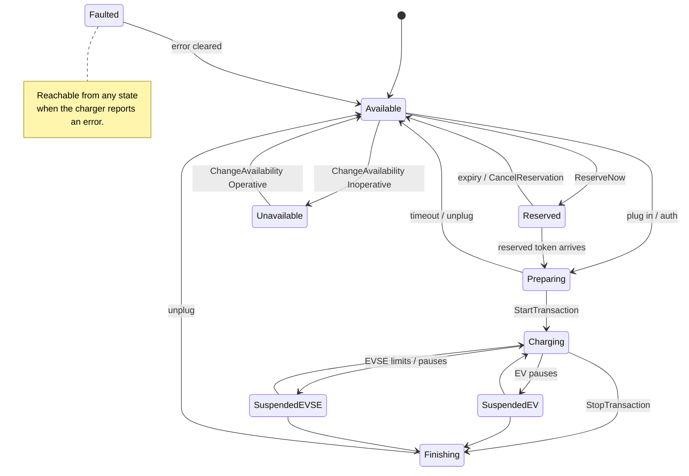
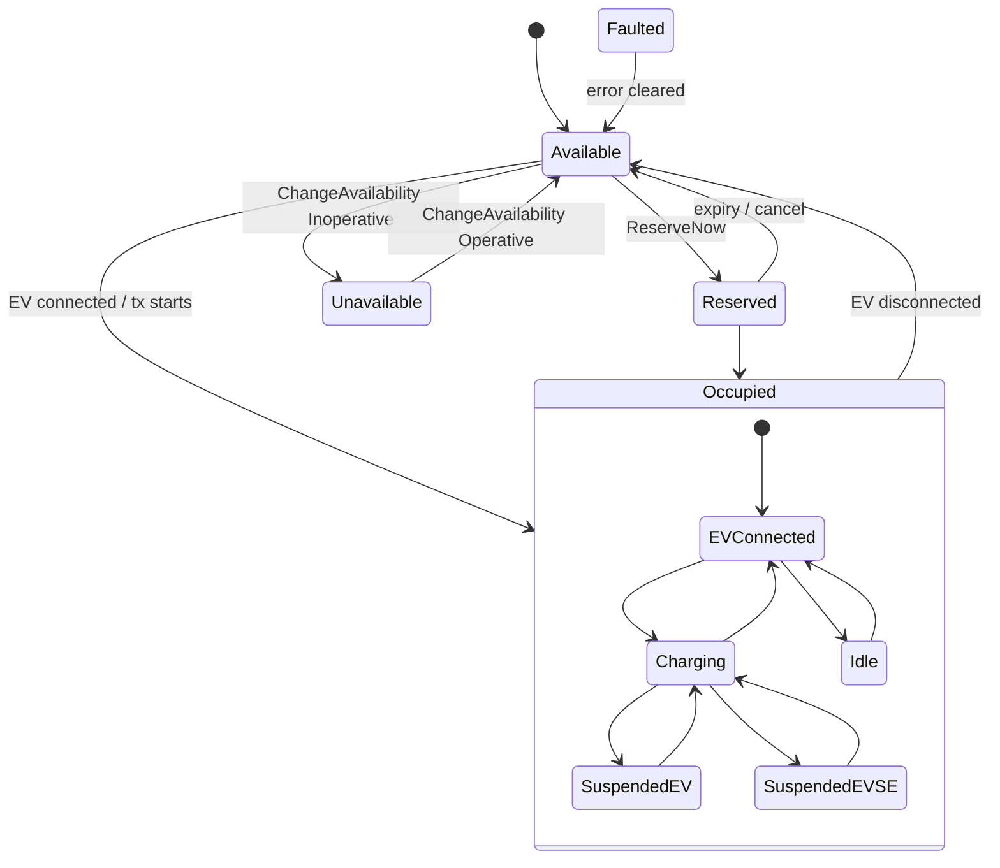

# 05 — OCPP Protocol Notes

Reference for the parts of OCPP 1.6-J and 2.0.1 that shape the CMS design. Library: [`mobilityhouse/ocpp`](https://github.com/mobilityhouse/ocpp), which handles OCPP-J framing and snake_case ↔ camelCase translation for both versions.

## OCPP 1.6 connector states

Reported via `StatusNotification`. Transactions use separate `StartTransaction` / `StopTransaction` calls, with `MeterValues` in between.

## OCPP 2.0.1 connector states

`StatusNotification` carries only five values. Charging detail moves into `chargingState` on `TransactionEvent`.

The `chargingState` enum is `EVConnected`, `Charging`, `SuspendedEV`, `SuspendedEVSE`, `Idle`. The nested transitions are illustrative. Store whatever the charger reports rather than enforcing them.

## Normalizing status across versions

**(Proposed — confirm against the schema.)** Store the raw value exactly as reported (in `status_notifications.raw` and the connector's raw status) and additionally derive a normalized pair `(availability, charging_state)` so dashboards query one shape:

| OCPP 1.6 status | Normalized availability | Normalized charging_state |
|---|---|---|
| Available | Available | — |
| Preparing | Occupied | EVConnected |
| Charging | Occupied | Charging |
| SuspendedEV | Occupied | SuspendedEV |
| SuspendedEVSE | Occupied | SuspendedEVSE |
| Finishing | Occupied | EVConnected |
| Reserved | Reserved | — |
| Unavailable | Unavailable | — |
| Faulted | Faulted | — |

For 2.0.1, `availability` comes straight from `StatusNotification` and `charging_state` from the latest `TransactionEvent`. The 1.6 → normalized mapping loses the Preparing/Finishing distinction, which is why the raw value is kept.

## Authorization cache vs local authorization list

Two separate mechanisms that are often confused:

| | Authorization cache | Local authorization list |
|---|---|---|
| Driven by | Charger, automatically | CSMS, explicitly |
| Contents | Results of past `Authorize` / `idTokenInfo` responses | A curated token list pushed by the CSMS |
| Managed with | `ClearCache` | `SendLocalList`, `GetLocalListVersion` |
| 1.6 config | `AuthorizationCacheEnabled` | `LocalAuthListEnabled`, `LocalAuthListMaxLength` |
| 2.0.1 config | `AuthCacheCtrlr.*` (enable, lifetime, policy) | `LocalAuthListCtrlr.*` |

Related offline / remote-start behaviour:

| Behaviour | OCPP 1.6 key | OCPP 2.0.1 variable |
|---|---|---|
| Authorize from cache/list before asking CSMS | `LocalPreAuthorize` | `AuthCtrlr.LocalPreAuthorize` |
| Authorize from cache/list while offline | `LocalAuthorizeOffline` | `AuthCtrlr.LocalAuthorizeOffline` |
| Accept unknown tokens while offline | — | `AuthCtrlr.OfflineTxForUnknownIdEnabled` |
| Send `Authorize` after a remote start | `AuthorizeRemoteTxRequests` | `AuthCtrlr.AuthorizeRemoteStart` |

### Implications for the CMS

- **Revocation has lag.** Blocking a token in `id_tokens` does not reach a charger until it re-authorizes or the CMS pushes `ClearCache` / `SendLocalList`. The block endpoint must trigger that push (see [Token revocation](03-flows.md#token-revocation)).
- **`idTokenInfo.expiryDate` is a tuning knob.** Short windows force frequent CMS checks (tighter security, more load). Long windows improve offline resilience but make revocation staler. This is an [open decision](../open-decisions.md).
- **Set auth-related keys at boot.** After `BootNotification`, push the fleet-standard values for the keys above so behaviour does not depend on per-vendor firmware defaults.
- **Redis caches auth reads for latency only.** Postgres `id_tokens` is authoritative.

## CSMS-initiated command names differ by version

| Internal action | OCPP 1.6 | OCPP 2.0.1 |
|---|---|---|
| Remote start | `RemoteStartTransaction` | `RequestStartTransaction` |
| Remote stop | `RemoteStopTransaction` | `RequestStopTransaction` |
| Reset | `Reset` (Hard / Soft) | `Reset` (Immediate / OnIdle) |
| Unlock | `UnlockConnector` (connectorId) | `UnlockConnector` (evseId, connectorId) |
| Availability | `ChangeAvailability` (connectorId) | `ChangeAvailability` (evse, operationalStatus) |

The API and command layer use the internal action names. Translation to the wire message happens only in the version-specific handler on the pod that owns the socket.

## Simulators

| Tool | Use |
|---|---|
| Solidstudio `ocpp-virtual-charge-point` | Day-to-day manual debugging, both versions |
| SAP `e-mobility-charging-stations-simulator` | Load testing (connection-count ceiling per pod) |
